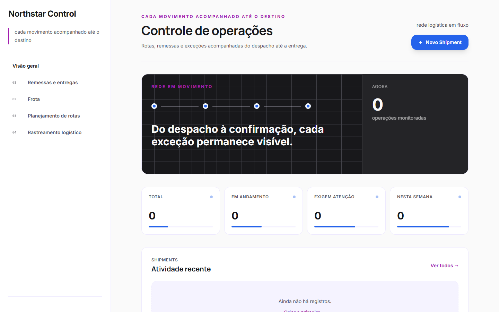

# ORUS Builder

> Do prompt ao projeto executável: planejamento de produto, identidade visual, geração de código, validação, reparo e entrega.

[](#estado-validado)
[](https://www.typescriptlang.org/)
[](https://nodejs.org/)
[](LICENSE)

O ORUS Builder é um gerador de aplicações 100% open source, distribuído sob licença MIT e executado na infraestrutura de quem o utiliza. A plataforma recebe uma ideia em linguagem natural, transforma o pedido em um Product Blueprint, define arquitetura, funcionalidades, componentes e identidade visual e, somente depois, inicia a geração do código.

O projeto combina uma arquitetura cognitiva em 16 camadas com engines especializadas, Trinity, protocolo CIG e um pipeline de certificação executável. O resultado não é liberado apenas porque arquivos foram produzidos: dependências, schema, migrações, testes, build, segurança, preview e integridade fazem parte do fluxo de entrega.

## O que o ORUS Builder entrega

- Geração por prompt ou por Product Blueprint estruturado.
- Landing pages, componentes, frontend, backend e aplicações full-stack.
- Planejamento prévio de produto, domínio, usuários, jornadas e regras de negócio.
- Identidade visual derivada da marca, do público e da intenção descrita no pedido.
- Interfaces responsivas com estruturas, navegação e composição adequadas ao produto.
- APIs Express, autenticação JWT, papéis, validação, persistência e testes quando exigidos pelo escopo.
- Projetos React + Vite em TypeScript ou JavaScript.
- Modelagem Prisma, migrations e seed para aplicações full-stack certificadas.
- Diagnóstico e reparo automático antes da entrega.
- Preview compilado, download em ZIP e artefatos de rastreabilidade.
- Checkpoints duráveis para preservar e continuar gerações interrompidas.

## Atualizações e correções do produto

### Planejamento antes do código

- O Product Blueprint passou a ser a fonte primária da geração.
- O pipeline agora determina produto, público, capacidades, entidades, telas, navegação, arquitetura e critérios de aceite antes de criar arquivos.
- Prompts simples são enriquecidos com o contexto necessário; documentos detalhados podem orientar diretamente o workspace.
- A geração deixou de tratar todo pedido como um CRUD genérico.
- Domínios conhecidos recebem estratégias próprias e domínios abertos extraem funcionalidades e modelos diretamente do pedido.

### Identidade visual e diversidade

- A identidade visual é definida antes da interface e registrada em artefatos do projeto.
- Cor, tipografia, densidade, raio, composição, navegação e hierarquia respondem à intenção visual do prompt.
- O gerador seleciona famílias de layout distintas para experiências editoriais, operacionais, comerciais, clínicas, educacionais, logísticas e orientadas a eventos.
- Telas especializadas substituem páginas genéricas quando o Blueprint descreve fluxos próprios do domínio.
- Cada página deve refletir sua função real em vez de repetir a mesma grade de cards e tabelas.
- Os projetos gerados preservam `brand-identity.json`, `experience-plan.json` e `design-system.json` em `.orus/`.

### Geração full-stack

- Controllers, services, repositories, schemas e rotas passaram a compartilhar o mesmo contrato de entidade.
- Prisma schema, migrations e seed são validados e executados durante a certificação.
- Entidades e campos duplicados no seed são detectados antes do build.
- Funcionalidades solicitadas recebem ações reais; endpoints simulados não podem ser promovidos como entrega concluída.
- Autenticação, autorização, estados de negócio, busca, filtros e persistência são gerados conforme o Blueprint.
- Stacks não suportadas são rejeitadas antes da criação do job, sem produzir uma falsa entrega.

### Preview e experiência do Builder

- O preview usa o projeto compilado e não uma representação estática do código.
- O backend encaminha os recursos do preview e mantém as rotas internas da aplicação acessíveis.
- Projetos demonstrativos abrem dentro da experiência principal; a tela de login não bloqueia a primeira visualização.
- Um gate de navegador verifica carregamento, erros de console, navegação e responsividade.
- Falhas de preview entram no mesmo ciclo de diagnóstico e reparo da geração.
- O frontend acompanha estágios, tentativas de correção, diagnósticos e resultado certificado.
- Mensagens de erro foram normalizadas para diferenciar falha de rede, falha de geração e falha de certificação.

### Continuidade e recuperação

- Jobs, projetos e Blueprints usam armazenamento durável configurável.
- O estado da geração pode ser retomado depois de atualização da página ou reinicialização do processo.
- Cada etapa relevante cria checkpoints e preserva diagnósticos.
- Uma regeneração inválida não substitui a última versão certificada.
- Artefatos intermediários permanecem disponíveis para novas tentativas de reparo.
- O acesso anônimo a resultados utiliza tokens opacos vinculados ao job.

### Qualidade, segurança e entrega

- O ciclo de correção recebe os arquivos relacionados ao erro, aplica mudanças e executa novamente os gates afetados.
- Diagnósticos de TypeScript, testes, Prisma, build, segurança, CIG e navegador são convertidos em contexto de reparo.
- O protocolo CIG antigo foi conectado ao fluxo ativo por uma camada de compatibilidade única.
- O ZIP certificado inclui manifestos e lockfile para reprodução da instalação.
- Backup e restauração verificam integridade por manifesto SHA-256.
- A automação contínua executa verificação geral, geração end-to-end, navegador end-to-end e isolamento em contêiner.
- O modo público pode exigir execução em contêiner e falha de forma fechada quando o isolamento obrigatório não está disponível.

## Como a geração funciona

```text
Prompt ou documento
        │
        ▼
Interpretação de intenção e domínio
        │
        ▼
Product Blueprint
  ├── proposta do produto
  ├── usuários e jornadas
  ├── funcionalidades e regras
  ├── entidades e dados
  ├── telas e componentes
  ├── arquitetura
  ├── identidade visual
  └── critérios de aceite
        │
        ▼
Plano de geração por engines
        │
        ▼
Frontend + backend + dados + testes
        │
        ▼
Workspace de execução
  ├── instalação de dependências
  ├── schema, migration e seed
  ├── lint e tipos
  ├── testes
  ├── build
  └── preview real
        │
        ▼
Diagnóstico e reparo automático
        │
        ▼
Segurança + CIG + gate de navegador
        │
        ▼
Projeto certificado
  ├── preview
  ├── código-fonte
  ├── ZIP reproduzível
  └── documentos do projeto
```

Se um gate falha, o projeto não é marcado como pronto. O diagnóstico retorna ao agente de reparo, que trabalha sobre o mesmo workspace e mantém o histórico da geração. A versão certificada anterior permanece preservada até que a nova versão seja aprovada.

## Arquitetura cognitiva

O ORUS Builder mantém a arquitetura original em 16 camadas e conecta cada responsabilidade ao pipeline ativo.

| Camada | Responsabilidade | Implementação principal |
| --- | --- | --- |
| 1. Foundation | Configuração, persistência, logging e erros | `backend/src/core` |
| 2. Shared Types | Contratos compartilhados | `shared` e tipos locais |
| 3. CIG Protocol | Integridade e certificação | CIG ativo em `engines` e `generation` |
| 4. Blueprint | Modelo estrutural do produto | `backend/src/blueprint` |
| 5. Generation | Código, UI, API, banco e testes | `backend/src/generation` |
| 6. Collaboration | Sessões e colaboração | `backend/src/collaboration` |
| 7. Deployment | Build, bundle, ambiente e preview | `backend/src/deployment` |
| 8. API | Controllers, middleware e rotas | `backend/src/controllers`, `middleware`, `routes` |
| 9. Prompt | Interpretação e enriquecimento | `backend/src/prompt` |
| 10. Marketplace | Catálogo e extensibilidade | `backend/src/marketplace` |
| 11. Monitoring | Métricas e observabilidade | `backend/src/monitoring` |
| 12. Trinity | Contexto e coordenação cognitiva | `backend/src/trinity` |
| 13. Security | Análise e políticas de segurança | `backend/src/security` |
| 14. Templates | Estruturas reutilizáveis | `backend/src/templates` |
| 15. Testing | Estratégia e execução de validações | `backend/src/testing` |
| 16. Engines | Orquestração das capacidades | `backend/src/engines` |

### Engines

O `OrchestratorEngine` coordena o fluxo do prompt à entrega. O `CognitiveGenerationEngine` materializa o projeto e combina as capacidades de Blueprint, prompt, UI, API, banco, testes, segurança, monitoring, learning, build, Trinity e CIG.

O `TemplateManager` oferece estruturas iniciais, mas a decisão final é guiada pelo Blueprint. Templates não substituem a interpretação do produto: eles fornecem uma base que as engines adaptam às funcionalidades, aos dados e à experiência solicitada.

### Trinity

Trinity organiza três responsabilidades cognitivas do ORUS:

- **ALMA:** contexto, intenção, domínio e significado do pedido.
- **CÉREBRO:** arquitetura, decomposição, dependências e decisões técnicas.
- **VOZ:** comunicação, refinamento e acompanhamento da geração.

### CIG

O CIG é o protocolo de integridade da geração. Ele consolida evidências do projeto, verifica coerência entre Blueprint e código e participa da decisão de certificação junto ao build, aos testes e à análise de segurança.

## Escopo certificado

| Área | Caminho ativo |
| --- | --- |
| Interface | React, Vite e Tailwind CSS |
| Linguagens | TypeScript e JavaScript |
| Backend | Node.js e Express |
| Dados do projeto gerado | Prisma e SQLite |
| Autenticação | JWT e papéis quando solicitados |
| Testes | Vitest, Supertest e Playwright |
| Entregas | Landing page, componente, frontend, backend e full-stack |
| Validação | Instalação, lint, tipos, testes, Prisma, build, runtime, segurança, CIG e navegador |
| Artefatos | Código, Blueprint, plano de aceite, identidade visual, design system, preview e ZIP |

## Estado validado

| Verificação | Resultado |
| --- | --- |
| Backend | 48 suítes e 317 testes aprovados |
| Frontend | 7 suítes e 23 testes aprovados |
| Qualidade estática | ESLint, TypeScript e builds aprovados |
| Dependências do monorepo | Auditoria sem vulnerabilidades moderadas ou superiores |
| Recuperação de dados | Backup, manifesto, restauração e verificação aprovados |
| Geração full-stack | Instalação, Prisma, testes, build, preview, segurança, CIG e download aprovados |
| Navegador end-to-end | 13 cenários aprovados |
| Continuidade | Recuperação de jobs e preservação da última versão certificada validadas |
| Isolamento | Execução sem rede e runtime limitado aprovados em contêiner Docker |

Os números acima representam a suíte executável do repositório. Novas capacidades só devem entrar nesta tabela depois de receberem um teste reproduzível.

## Projetos gerados

Os exemplos foram regenerados com o pipeline atual do ORUS Builder e representam produtos, identidades e estruturas diferentes. A coleção passou por instalação limpa, geração do Prisma Client, testes aplicáveis, build de produção e auditoria de dependências.

<table>
  <tr>
    <td width="50%">
      
      <br /><strong><a href="examples/showcase-2026/atlas-treasury/">Atlas Treasury</a></strong> — operação financeira e visão de tesouraria.
    </td>
    <td width="50%">
      
      <br /><strong><a href="examples/showcase-2026/amparo-care/">Amparo Care</a></strong> — experiência clínica e acompanhamento de cuidado.
    </td>
  </tr>
  <tr>
    <td width="50%">
      
      <br /><strong><a href="examples/showcase-2026/nocturne-atelier/">Nocturne Atelier</a></strong> — composição editorial para marca premium.
    </td>
    <td width="50%">
      
      <br /><strong><a href="examples/showcase-2026/northstar-control/">Northstar Control</a></strong> — logística de cadeia fria e resposta a incidentes.
    </td>
  </tr>
</table>

Coleção certificada:

| Projeto | Tipo | Características |
| --- | --- | --- |
| [Nocturne Atelier](examples/showcase-2026/nocturne-atelier/) | Landing page | Editorial de luxo, composição assimétrica e galeria |
| [Northstar Control](examples/showcase-2026/northstar-control/) | Full-stack | Remessas, frota, sensores e incidentes críticos |
| [Lumen Academy](examples/showcase-2026/lumen-academy/) | Full-stack | Cursos, trilhas, matrículas, avaliações e certificados |
| [Amparo Care](examples/showcase-2026/amparo-care/) | Full-stack | Agenda clínica, planos de cuidado e linha do tempo |
| [FrameFlow Studio](examples/showcase-2026/frameflow-studio/) | Full-stack | Produções, cenas, mídia, revisão e aprovação |
| [Atlas Treasury](examples/showcase-2026/atlas-treasury/) | Full-stack | Contas, transações, conciliação e aprovações |

Cada diretório inclui o prompt e os artefatos `.orus` que orientaram a geração. Todas as capturas estão reunidas em [`docs/assets/all-generated-apps`](docs/assets/all-generated-apps/).

## Estrutura do repositório

```text
Orus-Builder-FullStack/
├── backend/
│   ├── src/
│   │   ├── engines/
│   │   ├── generation/
│   │   ├── blueprint/
│   │   ├── deployment/
│   │   ├── prompt/
│   │   ├── security/
│   │   ├── testing/
│   │   ├── trinity/
│   │   ├── controllers/
│   │   └── routes/
│   └── tests/
├── frontend/src/
│   ├── pages/
│   ├── components/
│   ├── services/
│   ├── store/
│   └── config/
├── examples/showcase-2026/
├── scripts/
├── shared/
├── docs/
└── package.json
```

## Requisitos

- Node.js 20 ou superior
- npm 9 ou superior
- Git
- Windows, macOS ou Linux
- Acesso ao registro npm durante a certificação de projetos
- Chave de um provedor de IA compatível para geração e reparo assistidos
- MongoDB para persistência de produção; desenvolvimento possui fallback local
- Docker quando `ORUS_EXECUTION_ISOLATION=container-required`

## Início rápido

```bash
git clone https://github.com/OrusMind/Orus-Builder-FullStack.git
cd Orus-Builder-FullStack
npm ci
```

Copie o arquivo de ambiente e configure pelo menos os segredos e o provedor de IA:

```bash
cp .env.example backend/.env
```

Para implantação pública, use [`.env.production.example`](.env.production.example) como contrato de configuração e substitua todos os valores de exemplo.

Com Docker disponível, inicie o MongoDB persistente incluído na distribuição:

```bash
npm run infra:up
```

Configuração mínima para desenvolvimento:

```dotenv
NODE_ENV=development
PORT=5000
FRONTEND_URL=http://localhost:3000
CORS_ORIGIN=http://localhost:3000

AI_PROVIDER=groq
GROQ_API_KEY=sua-chave
GROQ_MODEL=llama-3.3-70b-versatile

MONGODB_URI=mongodb://localhost:27017/orus-builder
JWT_SECRET=gere-um-segredo-longo-e-aleatorio
SESSION_SECRET=gere-outro-segredo-longo-e-aleatorio
ENCRYPTION_KEY=gere-uma-chave-com-pelo-menos-32-caracteres

ORUS_EXECUTION_ISOLATION=process
ORUS_PREVIEW_BROWSER_GATE=true
```

Crie `frontend/.env.local`:

```dotenv
VITE_API_URL=http://localhost:5000
VITE_WS_URL=ws://localhost:5000
VITE_API_TIMEOUT=30000
```

Inicie backend e frontend juntos:

```bash
npm run dev
```

Para executar separadamente, use `npm run dev:backend` e `npm run dev:frontend` em dois terminais.

Abra [http://localhost:3000/generate](http://localhost:3000/generate). A API responde em [http://localhost:5000/health](http://localhost:5000/health).

## Prompt de exemplo

```text
Crie o Atlas Field, um sistema full-stack para equipes de manutenção industrial.

O produto deve permitir registrar ativos, planejar ordens de serviço, atribuir
técnicos por turno, acompanhar incidentes críticos e consultar o histórico de
cada equipamento. Crie perfis de administrador, coordenador, técnico e auditor.

Use uma experiência operacional de alta densidade, navegação superior com
atalhos de contexto e uma central de comando como tela inicial. Evite o padrão
de dashboard SaaS com sidebar fixa. A identidade deve usar grafite, âmbar e
branco, tipografia técnica e estados visuais claros para risco e prioridade.

Inclua autenticação, permissões, filtros, busca, persistência, validações,
tratamento de erros e dados iniciais realistas. Gere frontend React + TypeScript,
backend Express, Prisma, SQLite, migrations, seed e testes das ações principais.
```

Um bom prompt descreve o produto, os usuários, as operações, as regras, o comportamento visual e os critérios de aceite. O Blueprint completa lacunas sem apagar decisões explícitas do usuário.

## API de geração

```bash
curl -X POST http://localhost:5000/api/v1/generation/generate \
  -H "Content-Type: application/json" \
  -d '{
    "prompt": "Crie uma plataforma operacional para manutenção industrial",
    "framework": "react",
    "language": "typescript",
    "includeTests": true,
    "options": { "style": "industrial command center" }
  }'
```

| Método | Endpoint | Finalidade |
| --- | --- | --- |
| `POST` | `/api/v1/generation/generate` | Criar uma geração |
| `GET` | `/api/v1/generation/:generationId/status` | Consultar progresso e diagnósticos |
| `GET` | `/api/v1/generation/:generationId/result` | Obter o resultado certificado |
| `GET` | `/api/v1/generation/:generationId/preview` | Abrir o frontend compilado |
| `GET` | `/api/v1/generation/download/:generationId` | Baixar o projeto em ZIP |
| `POST` | `/api/v1/generation/:generationId/retry` | Continuar uma geração com falha |

## Qualidade e testes

Verificação completa do monorepo:

```bash
npm run verify
```

Geração full-stack end-to-end:

```bash
npm run verify:e2e
```

Matriz real de navegador:

```bash
npm run test:e2e:browser
```

Isolamento em contêiner:

```bash
npm run test:e2e:isolation
```

Comandos individuais:

```bash
npm run lint
npm run type-check
npm test
npm run test:frontend
npm run build
```

### Backup e restauração

```bash
npm run data:backup
npm run data:restore -- --directory caminho-do-backup
npm run test:data-recovery
```

## Tecnologias

- **Frontend do Builder:** React, TypeScript, Vite, Tailwind CSS, Zustand, TanStack Query, Monaco Editor e Sandpack.
- **Backend do Builder:** Node.js, TypeScript, Express, Socket.IO, Mongoose e Redis client.
- **Geração:** Cognitive Generation Engine, Product Blueprint, UI Generator, API Generator, Database Generator e Test Generator.
- **Certificação:** instalação real, Prisma, Vitest, build, runtime, Playwright, Security Engine e CIG.
- **Operação:** armazenamento durável, checkpoints, fila com concorrência controlada, backup e isolamento configurável.

## Próximas expansões

- Ampliar perfis de isolamento para diferentes ambientes de execução open source.
- Adicionar adaptadores reais de deployment com testes de contrato.
- Ampliar a edição contínua de projetos a partir do Blueprint preservado no workspace.
- Expandir colaboração, recuperação de conta e recursos corporativos com provedores verificáveis.
- Certificar novos stacks, incluindo Python, PHP e Rust, com o mesmo contrato de instalação, testes, reparo, runtime e entrega.
- Evoluir o catálogo de layouts, interações, componentes e avaliações de diversidade visual.

## Documentação

- [Primeiros passos](docs/GETTING-STARTED.md)
- [Arquitetura completa](docs/ARCHITECTURE-COMPLETE.md)
- [Arquitetura das engines](docs/ARCHITECTURE-ENGINES.md)
- [Integração das engines](docs/PLANO-INTEGRACAO-ENGINES.md)
- [Integração do Product Blueprint](docs/PLANO_INTEGRACAO_PRODUCT_BLUEPRINT.md)
- [Guia de provedores](docs/PROVIDER-SETUP-GUIDE.md)
- [Guia de prompts](docs/PROMPT-TUTORIAL-GUIDE.md)
- [Checklist de produção](docs/PRODUCTION-RELEASE-CHECKLIST.md)
- [Guia de execução open source](docs/SELF-HOSTING.md)
- [Contribuição](CONTRIBUTING.md)
- [Política de segurança](SECURITY.md)
- [Histórico de alterações](CHANGELOG.md)
- [Código de Conduta](CODE_OF_CONDUCT.md)
- [Suporte](SUPPORT.md)

## Contribuindo

Contribuições de código, testes, prompts de regressão, exemplos e documentação são bem-vindas. Alterações nas regras de geração devem incluir testes e passar por lint, type-check, suítes automatizadas e build.

Leia [CONTRIBUTING.md](CONTRIBUTING.md) e o [Código de Conduta](CODE_OF_CONDUCT.md).

## Segurança

O pipeline reduz falhas conhecidas e bloqueia entregas que não passam pelos gates configurados. A revisão do domínio continua necessária antes de operar dados reais, especialmente em autenticação, autorização, privacidade, regras regulatórias, infraestrutura e deployment.

Relate vulnerabilidades conforme a [Política de Segurança](SECURITY.md).

## Licença

ORUS Builder é distribuído sob a [Licença MIT](LICENSE).

---

**ORUS Builder — planejar, gerar, validar, reparar e entregar.**
