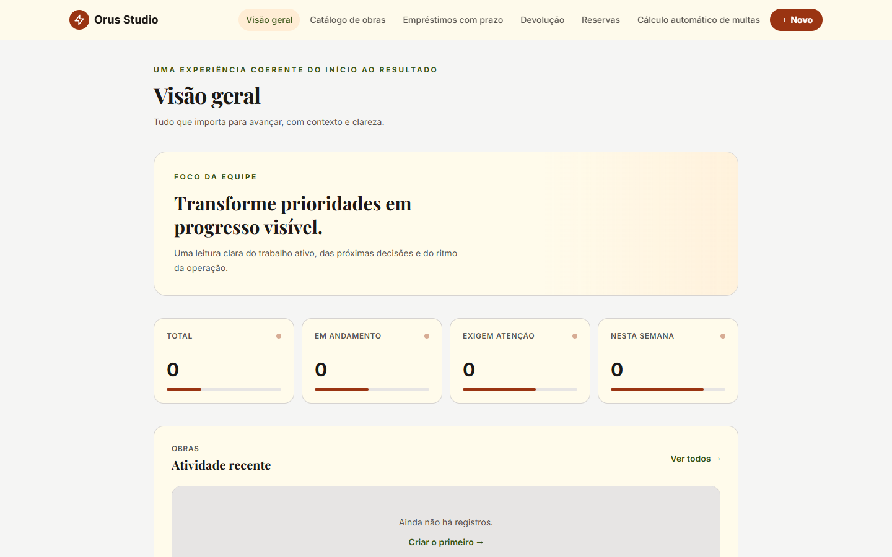
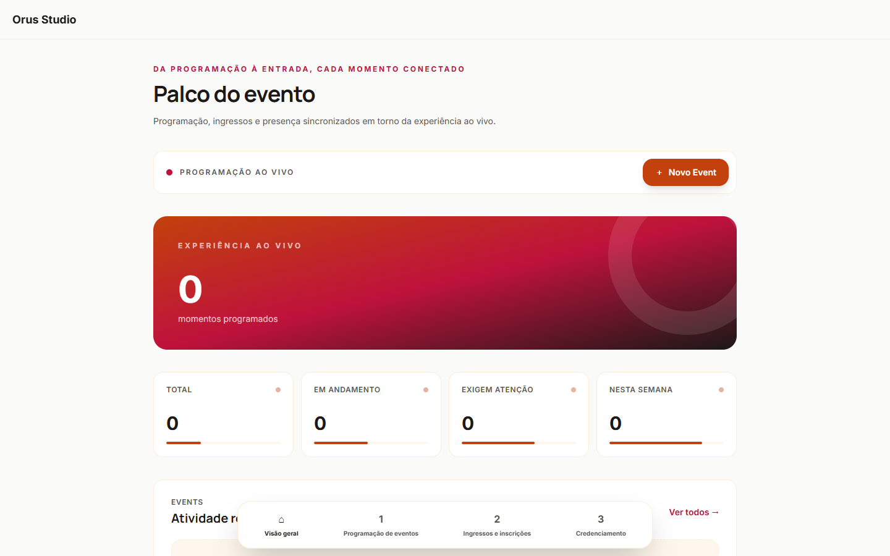
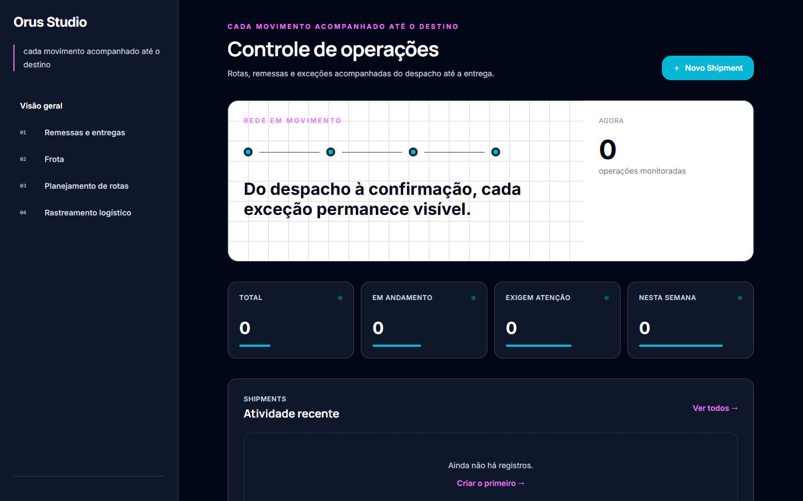
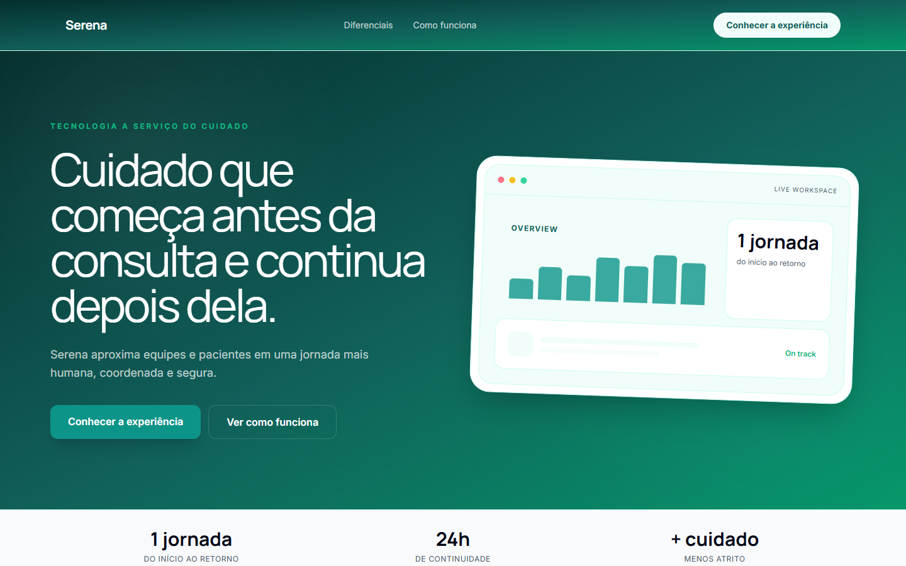
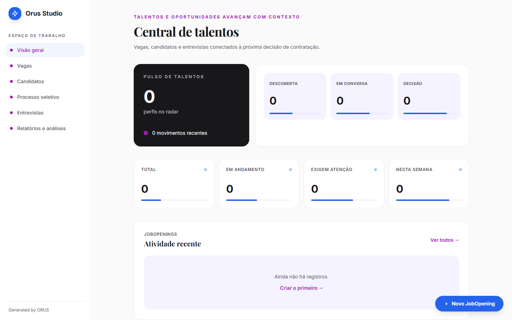
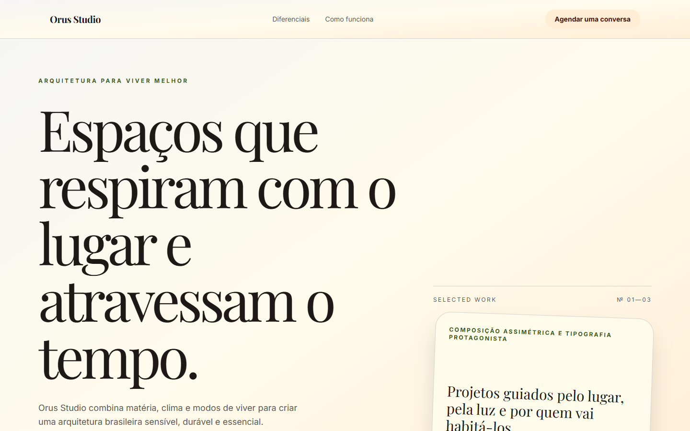
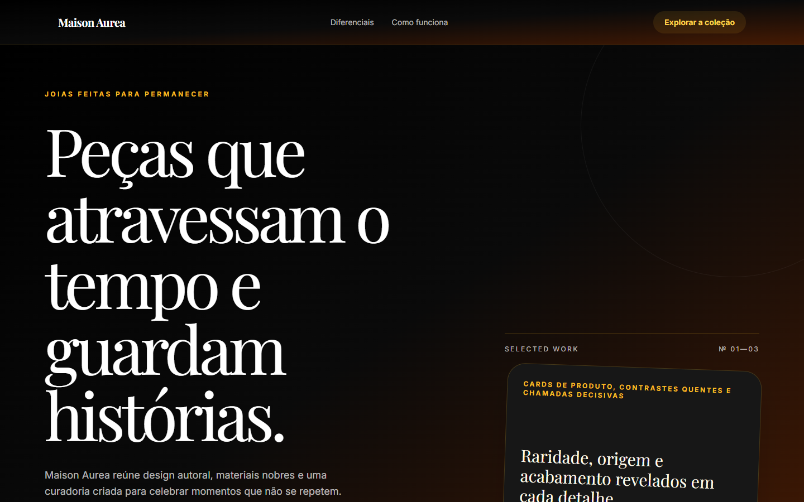
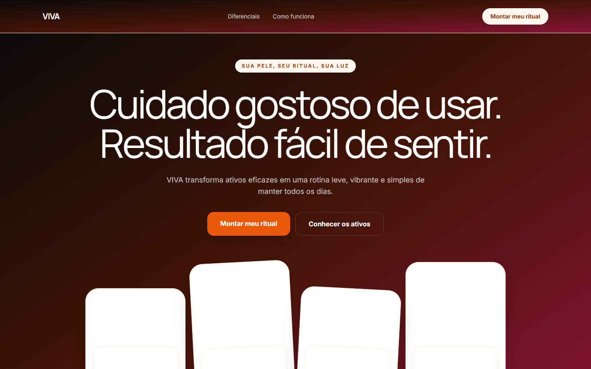

# Galeria de sistemas gerados

Capturas reais dos oito exemplos preservados em `examples/generated`, renderizados em 1440 × 900.

O repositório possui 16 projetos materializados: oito exemplos selecionados para documentação e oito artefatos de trabalho, testes ou versões intermediárias em `work`. A galeria abaixo contém somente o conjunto publicável.

## Aplicações fullstack

### Acervo Vivo

### Festival Vivo

### Rota Clara

### Serena Clínica

### Talento Vivo

## Landing pages e experiências de marca

### Atelier Terra

### Maison Aurea

### Viva Skincare

## Artefatos de trabalho não selecionados para o README

- Atlas Minimal;
- Pulse Playful;
- geração persistida `job-1790978180422-e50r7g3ee`;
- Fluxo Norte;
- Fluxo Norte v2;
- Casa Aurora;
- Casa Aurora v2;
- Visual Premium Demo.
