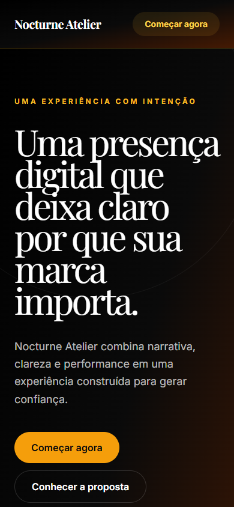
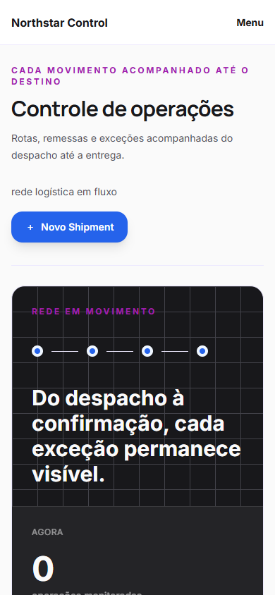
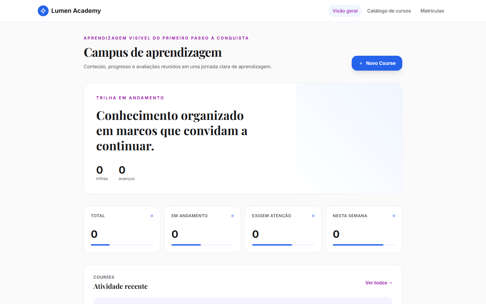
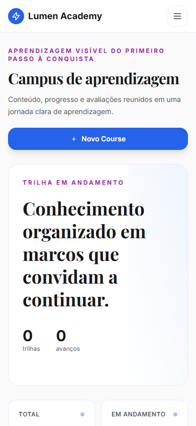
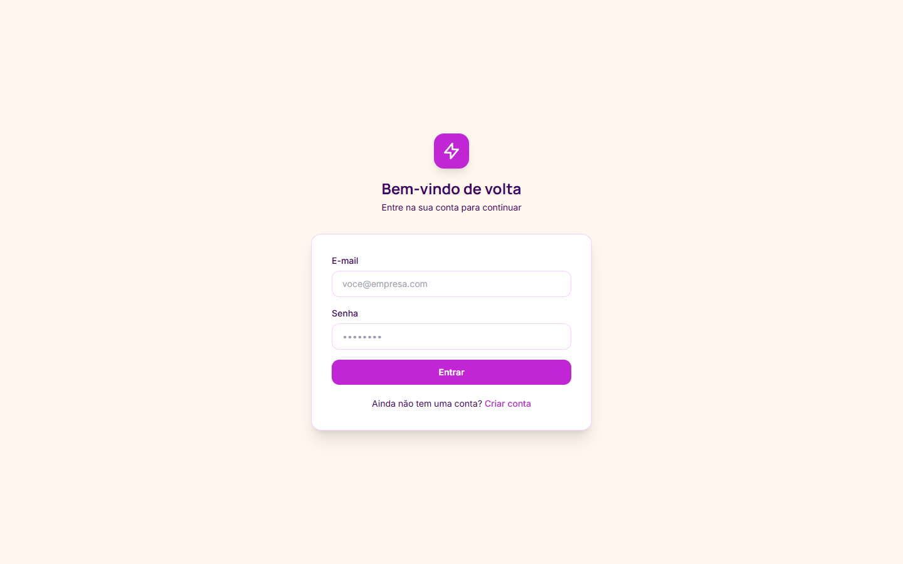
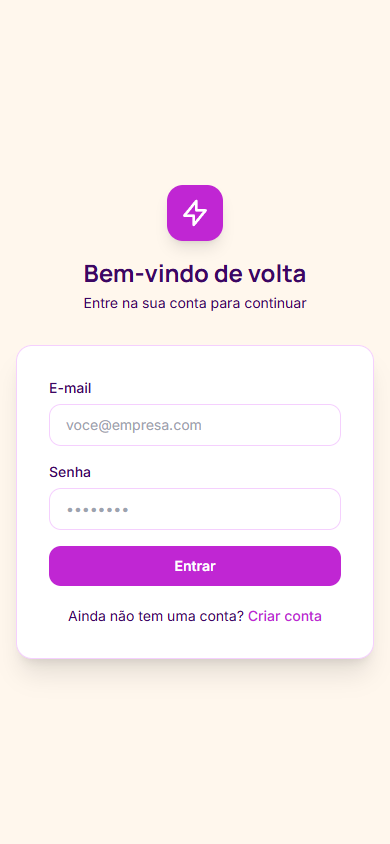
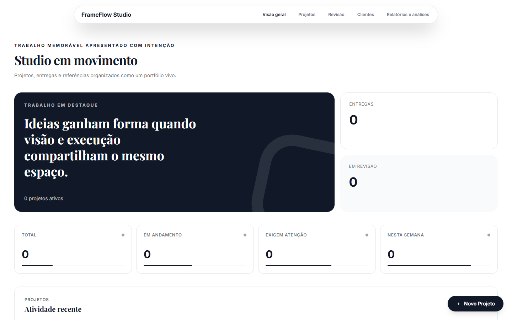
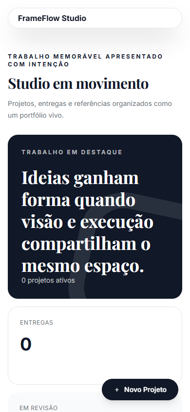
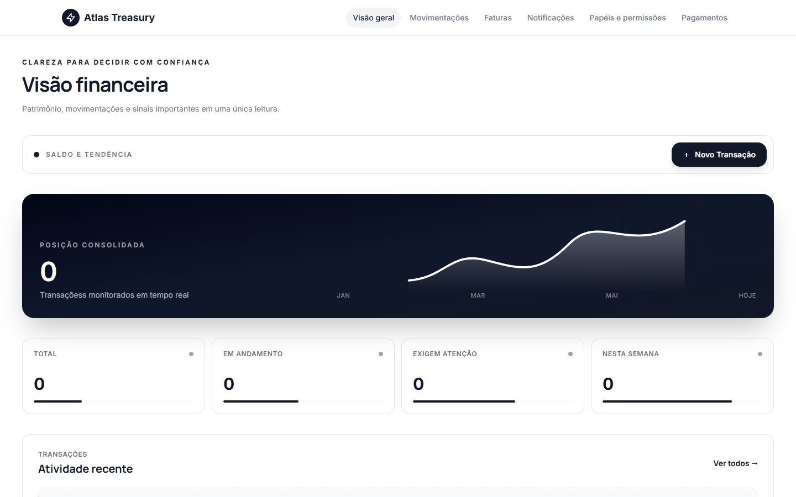
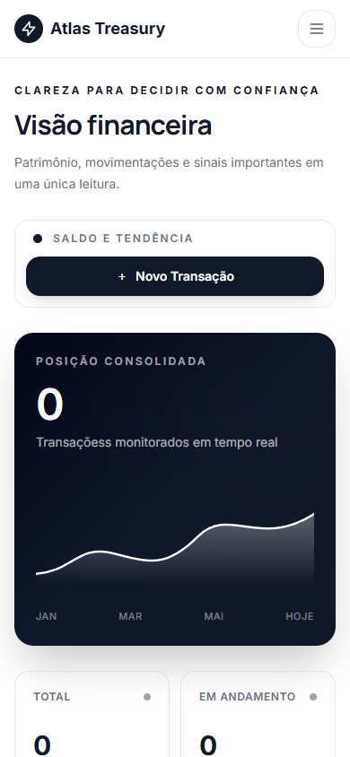

# ORUS Builder — Showcase 2026

Coleção gerada pelo pipeline atual do ORUS Builder a partir de seis prompts distintos. Cada projeto preserva o prompt, o Product Blueprint e os artefatos de identidade em sua pasta de origem.

## Resultado

- 6 projetos gerados: 5 fullstack e 1 landing page.
- Builds de frontend e backend aprovados nos seis projetos.
- Prisma Client e TypeScript aprovados nos cinco projetos fullstack.
- 12 capturas reais: desktop em 1440 × 900 e mobile em 390 × 844.
- Nenhum erro de página ou console durante as capturas.

## Nocturne Atelier

Landing page editorial para uma casa de mobiliário colecionável, com direção escura, tipografia monumental e composição assimétrica.

## Northstar Control

Central logística fullstack para remessas, frota, rotas, rastreamento, sensores e incidentes operacionais.

## Lumen Academy

Campus digital fullstack com catálogo, trilhas, aulas, matrículas, avaliações e certificados.

## Amparo Care

Aplicação clínica fullstack para cuidado materno, agenda, prontuário, continuidade e alertas.

## FrameFlow Studio

Workspace audiovisual fullstack para projetos, ativos, revisão, comentários, aprovação e entregas.

## Atlas Treasury

Sistema financeiro fullstack para contas, transações, faturas, projeção de caixa, conciliação e aprovações.

## Fontes

- Projetos: `examples/showcase-2026/`
- Prompts: `examples/showcase-2026/<projeto>/PROMPT.md`
- Blueprints: `examples/showcase-2026/<projeto>/.orus/product-blueprint.json`
- Identidade e experiência: `examples/showcase-2026/<projeto>/.orus/`
- Evidências das capturas: `docs/assets/showcase-2026/manifest.json`
